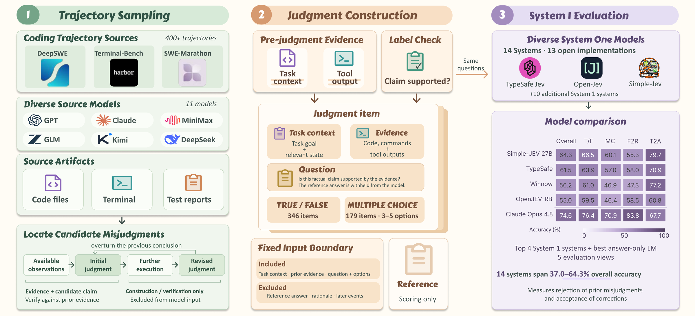

# DoubleTakeBench

**Can System 1 models correctly judge what coding agents observe?**

[](releases/final-benchmark/)
[](releases/final-benchmark/manifest.json)
[](#quick-start)

DoubleTakeBench tests model judgments at critical points in coding-agent
trajectories. Given context, tool output, and a question, a model chooses the
interpretation supported by the evidence. It supports evaluation of System 1
models and general language models on the same questions.

**Context and evidence -> judgment question -> model answer -> accuracy**



*Overview of trajectory sampling, judgment construction, and model evaluation.*
[PDF](assets/overview_pipeline.pdf).

## Dataset

| Split | Questions | Answer options |
| --- | ---: | --- |
| Binary | 346 | Correct / Incorrect |
| Multiclass | 179 | 3 options: 40; 4 options: 132; 5 options: 7 |
| **Total** | **525** | **2-5 options** |

Release: **`final-benchmark-20260926-v7`**. The benchmark measures accuracy on
difficult intermediate judgments in coding-agent trajectories.

### Example

A coding agent creates `interp/embed.go` without staging it, then runs
`git diff --stat && git diff --check`. The new file is absent from the output.

> **Claim:** The absence proves that Git's ignore rules are hiding the file.
>
> **Answer: Incorrect.** Default `git diff` omits untracked files. The output
> alone does not establish whether the file is ignored.

## Quick Start

Python 3.10+, with no additional dependencies.

```bash
git clone https://github.com/liulx25xx/DoubleTakeBench.git
cd DoubleTakeBench
```

Run and score a random baseline:

```bash
python3 scripts/public_benchmark.py baseline \
  --kind random --seed 7 --output runs/random.jsonl

python3 scripts/public_benchmark.py score \
  --predictions runs/random.jsonl --output runs/random-score.json
```

The seed-7 random baseline yields **211/525 (40.19%)**.

## Evaluate a Model

Use your own inference code or the included runner for an **OpenAI
Responses-compatible** endpoint.

```bash
export OPENAI_API_KEY='your-key'
export OPENAI_MODEL='your-model-id'
# Optional: export OPENAI_BASE_URL='https://provider.example/v1'

python3 scripts/run_public_eval.py --output runs/model.jsonl --resume

python3 scripts/public_benchmark.py score \
  --predictions runs/model.jsonl --output runs/model-score.json
```

Use `--split binary` or `--split multiclass` to select a split, and `--limit`
for a subset. `--resume` continues an existing run and retries failed items.
The default output budget is 32 tokens, adjustable with `--max-output-tokens`.

### Data and Prediction Format

Each line of `inputs.jsonl` is a JSON object:

| Field | Contents |
| --- | --- |
| `question_id` | Stable item identifier |
| `background` | Context before the judgment point |
| `state_assumptions` | Explicit assumptions |
| `evidence` | Evidence entries with `id` and `text` |
| `question` | The judgment to make |
| `options` | Answer options with `id` and `text` |
| `response_contract` | Allowed answer IDs and response instructions |

Write one prediction per question using its `question_id` and an answer ID:

```json
{"question_id":"q_...","answer":"A","status":"ok"}
```

The primary metric is **accuracy over all 525 questions**. Reports also include
split accuracy, option-count breakdowns, coverage, and accuracy on covered
items. Missing, duplicate, failed, invalid, and `DEFER` predictions receive
zero credit in full-release accuracy.

## Files

```text
releases/final-benchmark/
  binary/             # 346 questions: inputs, answers, metadata
  multiclass/         # 179 questions: inputs, answers, metadata
  manifest.json       # Version and dataset counts
scripts/
  public_benchmark.py # Offline baselines and scoring
  run_public_eval.py  # Optional model API runner
```

`inputs.jsonl` contains model inputs, `answers.json` contains scoring labels,
and `metadata.json` contains source information.

## Source and Citation

This dataset and evaluator were imported from the
[original project](https://github.com/AuQWQuA/deepswe-judgment-benchmark).
Citation metadata is available in [CITATION.cff](CITATION.cff).
